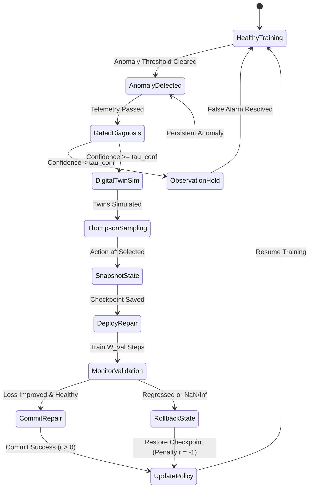

# Algorithm Specification & Mathematical Formulation

**Document:** Formal Mathematical & Algorithmic Foundation  
**System:** Adaptive Self-Healing Framework for Quantum Machine Learning  
**Date:** March 2026

---

## 1. Variational Quantum Circuit (VQC) Formulation

Let the quantum system consist of $n$ qubits with Hilbert space $\mathcal{H} = (\mathbb{C}^2)^{\otimes n}$.  
Given a classical input vector $\mathbf{x} \in \mathbb{R}^d$, the quantum state is prepared via an encoding feature map unitary $U_{\Phi}(\mathbf{x})$:
$$|\psi(\mathbf{x})\rangle = U_{\Phi}(\mathbf{x}) |0\rangle^{\otimes n}$$

A parameterized ansatz $U_A(\boldsymbol{\theta})$ consisting of $L$ layers is applied, where $\boldsymbol{\theta} \in [0, 2\pi]^P$ denotes the trainable parameter vector:
$$|\psi(\mathbf{x}, \boldsymbol{\theta})\rangle = U_A(\boldsymbol{\theta}) |\psi(\mathbf{x})\rangle = \prod_{l=1}^L \left( W_l \cdot \bigotimes_{j=1}^n R_y(\theta_{l, j}) \right) |\psi(\mathbf{x})\rangle$$
where $W_l$ represents an entangling layer (e.g., CNOT ladder or all-to-all CZ gates).

The model expectation value for Hermitian observable $\hat{M}$ is:
$$f(\mathbf{x}; \boldsymbol{\theta}) = \langle \psi(\mathbf{x}, \boldsymbol{\theta}) | \hat{M} | \psi(\mathbf{x}, \boldsymbol{\theta})\rangle$$

For binary classification $y \in \{0, 1\}$, predicted probability $\hat{y}$ is obtained via sigmoid or mapped expectation $\hat{y} = \frac{1}{2}(1 + \langle \hat{Z}_0 \rangle)$.  
The objective function over a mini-batch $\mathcal{B} = \{(\mathbf{x}_i, y_i)\}_{i=1}^B$ is binary cross-entropy or mean squared error:
$$\mathcal{L}(\boldsymbol{\theta}) = -\frac{1}{B} \sum_{i=1}^B \left[ y_i \ln \hat{y}_i + (1 - y_i) \ln (1 - \hat{y}_i) \right]$$

### Gradient Extraction via Parameter-Shift Rule
Exact analytic quantum gradients with respect to $\theta_j$ are computed without numerical finite differences via the two-point parameter-shift rule:
$$\frac{\partial f(\mathbf{x}; \boldsymbol{\theta})}{\partial \theta_j} = \frac{f(\mathbf{x}; \boldsymbol{\theta} + s \mathbf{e}_j) - f(\mathbf{x}; \boldsymbol{\theta} - s \mathbf{e}_j)}{2 \sin(s)}, \quad s = \frac{\pi}{2}$$
$$\nabla_{\boldsymbol{\theta}} \mathcal{L} = \left[ \frac{\partial \mathcal{L}}{\partial \theta_1}, \frac{\partial \mathcal{L}}{\partial \theta_2}, \dots, \frac{\partial \mathcal{L}}{\partial \theta_P} \right]^T$$

---

## 2. Health Monitoring Telemetry Vector

At each training epoch $t \in \{1, 2, \dots, T\}$, the telemetry monitoring engine records the health observation tuple $\mathbf{h}_t$:
$$\mathbf{h}_t = \left( \mathcal{L}_t, \mathcal{L}_{\text{val}, t}, \operatorname{Acc}_t, \|\mathbf{g}_t\|_2, \operatorname{Var}(\mathbf{g}_t), \|\boldsymbol{\theta}_t\|_2, \|\Delta \boldsymbol{\theta}_t\|_2, \eta_t, L_t \right)$$
where:
- $\mathbf{g}_t = \nabla_{\boldsymbol{\theta}} \mathcal{L}(\boldsymbol{\theta}_t)$ is the current gradient vector.
- $\|\mathbf{g}_t\|_2 = \sqrt{\sum_{j=1}^P g_{t, j}^2}$ is the Euclidean gradient norm.
- $\operatorname{Var}(\mathbf{g}_t) = \frac{1}{P} \sum_{j=1}^P (g_{t, j} - \bar{g}_t)^2$ is the gradient component variance.
- $\|\Delta \boldsymbol{\theta}_t\|_2 = \|\boldsymbol{\theta}_t - \boldsymbol{\theta}_{t-1}\|_2$ is parameter displacement velocity.
- $L_t$ is the current circuit depth.

A sliding window buffer of length $W$ maintains recent history:
$$\mathcal{W}_t = \{\mathbf{h}_{t - k}\}_{k=0}^{W - 1}$$

### Controlled Failure Injection & Barren Plateau Definitions
To ensure scientific integrity, we strictly distinguish between two modes of barren plateau testing:
1. **Genuine Structural Barren Plateau ($\mathcal{F}_{\text{BP-struct}}$):**  
   Occurs when parameterized quantum circuits form approximate 2-designs under Haar-distributed random parameters, or when deep entangling architectures cause exponential concentration of measure $\operatorname{Var}[\partial_\theta \mathcal{L}] \in \mathcal{O}(2^{-n})$. This is evaluated by scaling qubit count $n$ and layer depth $L$ with Haar-random initialization $\boldsymbol{\theta} \sim \mathcal{U}[0, 2\pi]^P$.
2. **Synthetic Flat-Landscape / Attenuation Surrogate ($\mathcal{F}_{\text{BP-synth}}$):**  
   Used strictly as a controlled software test hook to evaluate whether the telemetry monitoring and detection rules fire reliably upon gradient vanishing. Parameters are injected into an analytically engineered flat manifold where $\|\mathbf{g}\| < 10^{-6}$.  
   *Scientific Notice:* A synthetic low-gradient injection is an empirical test hook for detection sensitivity; it is never claimed as experimental proof of the theoretical barren plateau phenomenon.

---

## 3. Failure Detection Engine

The failure detector evaluates multi-window statistical rules over $\mathcal{W}_t$ against six formal anomaly conditions:

1. **Barren Plateau ($\mathcal{F}_{\text{BP}}$):**
   $$\operatorname{Var}(\mathbf{g}_t) < \epsilon_{\text{BP}} \cdot 2^{-n} \quad \text{AND} \quad \|\Delta \boldsymbol{\theta}_t\|_2 < \epsilon_{\text{vel}} \quad \text{for } \ge W_{\text{BP}} \text{ consecutive steps}$$
   *(Distinguishes a true exponential barren plateau from a transient saddle point).*

2. **Learning-Rate Misconfiguration ($\mathcal{F}_{\text{LR}}$):**
   $$\text{Oscillatory Divergence: } \operatorname{sign}(\Delta \mathcal{L}_t) \ne \operatorname{sign}(\Delta \mathcal{L}_{t-1}) \quad \text{AND} \quad |\Delta \mathcal{L}_t| > \delta_{\text{osc}}$$
   $$\text{OR Stagnation: } \|\Delta \boldsymbol{\theta}_t\|_2 < \epsilon_{\text{vel}} \quad \text{while } \|\mathbf{g}_t\|_2 > \gamma_{\text{grad}}$$

3. **Optimizer Instability ($\mathcal{F}_{\text{OPT}}$):**
   $$\frac{\sigma(\mathcal{L}_{t-W:t})}{\mu(\mathcal{L}_{t-W:t})} > \kappa_{\text{instability}} \quad \text{with erratic step angle } \arccos\left(\frac{\mathbf{g}_t^T \mathbf{g}_{t-1}}{\|\mathbf{g}_t\| \|\mathbf{g}_{t-1}\|}\right) \approx \pi$$

4. **Training Divergence ($\mathcal{F}_{\text{DIV}}$):**
   $$\mathcal{L}_t > \Omega_{\text{diverge}} \quad \text{OR} \quad \mathcal{L}_t = \text{NaN/Inf} \quad \text{OR} \quad \|\mathbf{g}_t\|_2 > G_{\text{max}}$$

5. **Persistent Loss Plateau ($\mathcal{F}_{\text{PLT}}$):**
   $$\max_{k \in [1, W]} |\mathcal{L}_t - \mathcal{L}_{t-k}| < \epsilon_{\text{plateau}} \quad \text{while } \mathcal{L}_t > \mathcal{L}_{\text{acceptable}}$$

6. **Noise-Related Degradation ($\mathcal{F}_{\text{NSE}}$):**
   $$\text{Train-Val Divergence: } (\mathcal{L}_{\text{val}, t} - \mathcal{L}_{\text{train}, t}) > \zeta_{\text{noise}} \quad \text{with elevated state entropy or variance}$$

---

## 4. Probabilistic Root-Cause Diagnosis & Confidence Gating

The diagnosis engine takes detected anomalies and telemetry $\mathcal{W}_t$ to compute a normalized posterior belief vector over the failure categories:
$$\mathbf{p}_t = [p_{\text{BP}}, p_{\text{LR}}, p_{\text{OPT}}, p_{\text{DIV}}, p_{\text{PLT}}, p_{\text{NSE}}]^T, \quad \sum_{c} p_c = 1, \quad p_c \ge 0$$

The belief score $s_c$ for each cause $c$ is computed using an evidence weighting kernel:
$$s_c = \sum_{k} w_{c, k} \cdot \phi_k(\mathcal{W}_t)$$
where $\phi_k(\mathcal{W}_t) \in [0, 1]$ are normalized feature indicators (e.g., gradient vanishing score, oscillation frequency, loss slope).  
The probabilities are obtained via softmax with temperature $T_d$:
$$p_c = \frac{\exp(s_c / T_d)}{\sum_{j} \exp(s_j / T_d)}$$

### Confidence Gate
A repair is only initiated if the primary diagnostic confidence clears the threshold $\tau_{\text{conf}}$:
$$\max_{c} p_c \ge \tau_{\text{conf}} \quad (\text{Default: } \tau_{\text{conf}} = 0.60)$$
If $\max_c p_c < \tau_{\text{conf}}$, the system **abstains from blind repair** and triggers a safe observation window of $\Delta t_{\text{obs}}$ epochs.

---

## 5. Failure Memory & Cosine Similarity Retrieval

Each diagnosed failure instance is compressed into a failure embedding $\mathbf{e}_f \in \mathbb{R}^{d_e}$ derived from normalized telemetry:
$$\mathbf{e}_f = \left[ \bar{\mathcal{L}}_W, \bar{\|\mathbf{g}\|}_W, \bar{\operatorname{Var}(\mathbf{g})}_W, \bar{\|\Delta \boldsymbol{\theta}\|}_W, \mathbf{p}_t^T, \eta_t, L_t / L_{\text{max}} \right]^T$$

Persistent memory stores historical episodes $\mathcal{M} = \{(\mathbf{e}_i, a_i, r_i, \Delta \mathcal{L}_i)\}_{i=1}^{|\mathcal{M}|}$.  
Upon a new failure with embedding $\mathbf{e}_{\text{query}}$, similarity scores are calculated via Cosine Similarity:
$$\operatorname{Sim}(\mathbf{e}_{\text{query}}, \mathbf{e}_i) = \frac{\mathbf{e}_{\text{query}} \cdot \mathbf{e}_i}{\|\mathbf{e}_{\text{query}}\|_2 \|\mathbf{e}_i\|_2} \in [-1, 1]$$

The top-$K$ historical nearest neighbors are retrieved:
$$\mathcal{N}_K(\mathbf{e}_{\text{query}}) = \operatorname{arg top-}K_{i \in \mathcal{M}} \operatorname{Sim}(\mathbf{e}_{\text{query}}, \mathbf{e}_i)$$
The historical success rate $\bar{r}_{a, \text{hist}}$ for each candidate arm $a$ is incorporated into the contextual bandit feature vector.

---

## 6. Safety Filter & Anti-Oscillation Layer

Before any candidate repair $a \in \{1, \dots, 6\}$ is considered, the safety filter validates the candidate against operational bounds:
1. **Anti-Oscillation:** Reject action $a$ if $a$ directly reverses an action applied within the last $K_{\text{osc}}$ steps (e.g., increasing LR immediately after decreasing LR).
2. **Circuit Complexity Bound:** Reject circuit depth increase or feature map expansions exceeding qubit/gate limits: $L \le L_{\text{max}}$.
3. **Repeated Failure Penalty:** Reject arm $a$ if it failed ($r < 0$) in the last 2 consecutive attempts on this model.
4. **Learning Rate Range:** Enforce $\eta_{\text{min}} \le \eta \le \eta_{\text{max}}$.

---

## 7. Digital-Twin Proxy Pre-Deployment Simulation

To avoid destructive updates on the primary quantum circuit, the system constructs a short-horizon Digital Twin $\mathcal{T}_{\text{proxy}}$ with an explicitly locked horizon of **$H = 3$ optimization steps**:
1. $\mathcal{T}_{\text{proxy}}$ clones the exact parameter vector $\boldsymbol{\theta}_t$, optimizer buffers, and dataset batch pointers into an isolated workspace.
2. The candidate repair $a$ is applied to $\mathcal{T}_{\text{proxy}}$.
3. $\mathcal{T}_{\text{proxy}}$ executes exactly $H = 3$ training iterations on a validation batch.
4. The digital twin records the proxy loss trajectory $\{\mathcal{L}_{\text{proxy}, h}\}_{h=1}^3$.
5. The digital twin outputs:
   - **Predicted Normalized Improvement:** $\widehat{\Delta \mathcal{L}}_a = \mathcal{L}_t - \mathcal{L}_{\text{proxy}, 3}$
   - **Proxy Stability Score:** $S_{\text{proxy}} = \text{clip}\left(1 - \frac{\operatorname{std}(\mathcal{L}_{\text{proxy}})}{\operatorname{mean}(\mathcal{L}_{\text{proxy}}) + 10^{-8}}, 0, 1\right)$
   - **Simulation Uncertainty:** $\sigma_{\text{twin}}^2$ estimated from proxy gradient variance.

If $\widehat{\Delta \mathcal{L}}_a < -0.20 \cdot \mathcal{L}_t$ (the repair provably makes proxy loss $\ge 20\%$ worse in 3 steps), the repair is rejected by the safety filter before primary deployment.

---

## 8. Implementation & Validation Procedures for Specific Repair Arms

To ensure scientific precision, the implementation and validation procedures for the three complex arms are locked:

### Arm 3: Modify Feature Map
- **Implementation:** Transforms the encoding unitary $U_\Phi(\mathbf{x})$:
  - *Angle Embedding:* Rotations $R_x(x_i)$ or $R_y(x_i)$ on qubit $i$.
  - *IQP / ZZFeatureMap:* $U_{\Phi}(\mathbf{x}) = \exp\left(i \sum_{j} x_j \hat{Z}_j + \sum_{j < k} (\pi - x_j)(\pi - x_k) \hat{Z}_j \hat{Z}_k\right)$.
- **Validation:** Must be validated on a held-out test batch to verify expressive capacity without increasing qubit requirement.

### Arm 5: Apply Noise Mitigation
- **Scope & Distinction:** Strictly simulation-side error mitigation. Hardware claims are quarantined until real QPU execution.
- **Implementation:** Zero-Noise Extrapolation (ZNE) using linear/polynomial Richardson extrapolation across scale factors $c \in \{1.0, 1.5, 2.0\}$ via unitary folding ($U \to U(U^\dagger U)^m$), and readout error mitigation via measurement confusion matrix inversion $\mathbf{P}_{\text{corrected}} = \mathbf{M}^{-1} \mathbf{P}_{\text{measured}}$.
- **Validation:** Measure expectation value bias reduction on noisy classical simulation vs noiseless target.

### Arm 6: Perform Warm Restart
- **Implementation:** Avoids destructive random initialization:
  - Mode A (Identity Block): Set parameter layers to identity-equivalent angles $\theta \approx 0 \pmod{2\pi}$, preventing random Haar-scrambling.
  - Mode B (Perturbation around Best Checkpoint): Revert to historical best parameters $\boldsymbol{\theta}_{\text{best}}$ and add small isotropic Gaussian perturbation $\boldsymbol{\theta} \leftarrow \boldsymbol{\theta}_{\text{best}} + \mathcal{N}(0, \sigma^2 \mathbf{I})$ with $\sigma = 0.05$.
- **Validation:** Confirm loss is bounded below pre-fault loss within 3 steps.

---

## 9. Multi-Objective Reward Function

The reward $r \in [-1, 1]$ evaluates repair quality post-deployment across six distinct, normalized, non-redundant criteria:
$$r = w_1 \cdot \widetilde{\Delta \mathcal{L}} + w_2 \cdot \widetilde{\Delta \operatorname{Acc}} + w_3 \cdot \widetilde{R}_{\text{grad}} - w_4 \cdot \widetilde{C}_{\text{compute}} - w_5 \cdot \widetilde{\Delta L} - w_6 \cdot \mathbb{I}_{\text{rollback}}$$

### Component Definitions & Boundary Normalizations:
1. **Normalized Loss Improvement ($\widetilde{\Delta \mathcal{L}} \in [-1, 1]$):**
   $$\widetilde{\Delta \mathcal{L}} = \text{clip}\left(\frac{\mathcal{L}_{\text{pre}} - \mathcal{L}_{\text{post}}}{\max(\mathcal{L}_{\text{pre}}, 10^{-6})}, -1.0, 1.0\right)$$
   Measures fractional loss reduction without double-counting absolute magnitudes.
2. **Accuracy Delta ($\widetilde{\Delta \operatorname{Acc}} \in [-1, 1]$):**
   $$\widetilde{\Delta \operatorname{Acc}} = \operatorname{Acc}_{\text{post}} - \operatorname{Acc}_{\text{pre}}$$
3. **Gradient Health Restoration ($\widetilde{R}_{\text{grad}} \in [-1, 1]$):**
   $$\widetilde{R}_{\text{grad}} = \begin{cases} \tanh\left(\frac{\|\mathbf{g}_{\text{post}}\|_2 - \|\mathbf{g}_{\text{pre}}\|_2}{\|\mathbf{g}_{\text{pre}}\|_2 + 10^{-6}}\right) & \text{if fault was Barren Plateau or Stagnation} \\ 0.0 & \text{otherwise} \end{cases}$$
   *Scientific Notice:* Restricting this term to vanishing-gradient faults prevents double-counting with loss improvement during standard optimization.
4. **Normalized Computational Cost ($\widetilde{C}_{\text{compute}} \in [0, 1]$):**
   $$\widetilde{C}_{\text{compute}} = \min\left(1.0, \frac{\text{Circuit Evaluations Incurred}}{100}\right)$$
5. **Circuit Complexity Penalty ($\widetilde{\Delta L} \in [0, 1]$):**
   $$\widetilde{\Delta L} = \frac{\max(0, L_{\text{post}} - L_{\text{pre}})}{L_{\text{max}}}$$
   Penalizes repairs that increase depth, encouraging compact, hardware-efficient circuits.
6. **Rollback Penalty ($\mathbb{I}_{\text{rollback}} \in \{0, 1\}$):**
   $$\mathbb{I}_{\text{rollback}} = \begin{cases} 1 & \text{if post-deployment metrics triggered automatic rollback} \\ 0 & \text{if repair was successfully retained} \end{cases}$$

### Locked Weight Distribution:
$$w_1 = 0.40, \quad w_2 = 0.25, \quad w_3 = 0.15, \quad w_4 = 0.05, \quad w_5 = 0.05, \quad w_6 = 0.10$$
$$\sum_{i=1}^6 w_i = 1.00, \quad r \in [-1.0, 1.0]$$

---

## 8. Contextual Thompson Sampling Formulation

Repair selection is formalized as a Multi-Armed Bandit with linear contextual payoff for each of the $K=6$ arms:
$$\mathcal{A} = \{a_1: \text{Optimizer}, a_2: \text{Depth}, a_3: \text{Feature Map}, a_4: \text{Learning Rate}, a_5: \text{Noise Mitigation}, a_6: \text{Warm Restart}\}$$

### Explicit Context Vector Definition ($\mathbf{x} \in \mathbb{R}^{12}$)
At decision step $k$, given failure telemetry, diagnosis probabilities, persistent memory search, and digital twin proxy estimates, the 12-dimensional context vector $\mathbf{x} = [x_1, x_2, \dots, x_{12}]^T$ is rigorously constructed as follows:

| Index | Feature Symbol | Mathematical Definition | Raw Range | Normalization Formula | Missing / Cold-Start Value |
|---|---|---|---|---|---|
| $x_1$ | $\text{Bias}$ | Constant offset | $1.0$ | $x_1 = 1.0$ | $1.0$ (Always present) |
| $x_2$ | $\widetilde{\mathcal{L}}_t$ | Current training loss | $[0, \infty)$ | $x_2 = \tanh(\mathcal{L}_t)$ | $0.5$ if loss is NaN/Inf (flagged) |
| $x_3$ | $\widetilde{\|\mathbf{g}\|}$ | Log gradient norm | $[0, \infty)$ | $x_3 = \text{clip}\left(\frac{\ln(\|\mathbf{g}_t\|_2 + 10^{-8}) + 8}{12}, -1, 1\right)$ | $-1.0$ if gradient norm $\le 10^{-8}$ |
| $x_4$ | $\widetilde{\operatorname{Var}}(\mathbf{g})$ | Log gradient variance | $[0, \infty)$ | $x_4 = \text{clip}\left(\frac{\ln(\operatorname{Var}(\mathbf{g}_t) + 10^{-10}) + 10}{14}, -1, 1\right)$ | $-1.0$ if variance $\le 10^{-10}$ |
| $x_5$ | $\widetilde{v}_\theta$ | Parameter velocity | $[0, \infty)$ | $x_5 = \tanh(10 \cdot \|\boldsymbol{\theta}_t - \boldsymbol{\theta}_{t-1}\|_2)$ | $0.0$ at epoch 0 |
| $x_6$ | $\widetilde{L}$ | Relative circuit depth | $[1, L_{\text{max}}]$ | $x_6 = \frac{L_t}{L_{\text{max}}} \in [0, 1]$ | $0.25$ if uninitialized |
| $x_7$ | $p_{\text{primary}}$ | Max diagnosis probability | $[0, 1]$ | $x_7 = \max_c p_c \in [1/6, 1.0]$ | $1/6 \approx 0.167$ (uniform) |
| $x_8$ | $\widetilde{H}(\mathbf{p})$ | Diagnosis entropy | $[0, \ln 6]$ | $x_8 = \frac{-\sum_c p_c \ln(p_c + 10^{-12})}{\ln 6} \in [0, 1]$ | $1.0$ (maximum uncertainty) |
| $x_9$ | $\bar{r}_{\text{hist}}$ | Historical memory prior reward | $[-1, 1]$ | $x_9 = \text{clip}(\bar{r}_{\text{top-K}}, -1, 1)$ | $0.0$ (uninformative cold-start prior) |
| $x_{10}$| $S_{\text{hist}}$ | Top historical similarity | $[-1, 1]$ | $x_{10} = \max_{i} \operatorname{Sim}(\mathbf{e}_{\text{query}}, \mathbf{e}_i)$ | $0.0$ if memory is empty |
| $x_{11}$| $\widetilde{\Delta \mathcal{L}}_{\text{twin}}$ | Digital-twin predicted loss delta | $(-\infty, \infty)$ | $x_{11} = \tanh\left(\frac{\mathcal{L}_t - \mathcal{L}_{\text{proxy}, H}}{\mathcal{L}_t + 10^{-8}}\right) \in [-1, 1]$ | $0.0$ if proxy unsimulated |
| $x_{12}$| $S_{\text{proxy}}$ | Digital-twin proxy stability | $[0, 1]$ | $x_{12} = \text{clip}\left(1 - \frac{\operatorname{std}(\mathcal{L}_{\text{proxy}})}{\operatorname{mean}(\mathcal{L}_{\text{proxy}}) + 10^{-8}}, 0, 1\right)$ | $0.5$ if proxy unsimulated |

*Imputation and Robustness Notice:* If numerical overflow (NaN/Inf) occurs in telemetry, feature values are clipped to their boundary flags ($x_2 = 1.0, x_3 = 1.0$) to prevent NaN propagation into the Bayesian posterior updates.

### Bayesian Linear Regression Model
For each arm $a \in \mathcal{A}$, the expected reward given context $\mathbf{x}$ is modeled as:
$$r_a(\mathbf{x}) = \mathbf{x}^T \boldsymbol{\beta}_a + \epsilon_a, \quad \epsilon_a \sim \mathcal{N}(0, \sigma^2)$$

The algorithm maintains a Gaussian conjugate posterior over the regression weights $\boldsymbol{\beta}_a \sim \mathcal{N}(\boldsymbol{\mu}_a, \mathbf{B}_a^{-1})$:
- Prior: $\boldsymbol{\mu}_a^{(0)} = \mathbf{0}$, $\mathbf{B}_a^{(0)} = \lambda \mathbf{I}_d$ (with $\lambda = 1.0$).
- Covariance: $\boldsymbol{\Sigma}_a = v^2 \mathbf{B}_a^{-1}$ (where $v > 0$ controls exploration scale).

### Thompson Sampling Decision Rule
1. For each eligible arm $a \in \mathcal{A}_{\text{safe}}$:
   Sample a parameter vector from its posterior:
   $$\tilde{\boldsymbol{\beta}}_a \sim \mathcal{N}(\boldsymbol{\mu}_a, v^2 \mathbf{B}_a^{-1})$$
   Compute sampled expected reward:
   $$\tilde{r}_a = \mathbf{x}^T \tilde{\boldsymbol{\beta}}_a$$
2. Select the optimal action:
   $$a^* = \arg\max_{a \in \mathcal{A}_{\text{safe}}} \tilde{r}_a$$

### Online Recursive Posterior Update
Upon observing actual reward $r_{\text{actual}}$ after deployment:
$$\mathbf{B}_{a^*}^{(k+1)} = \mathbf{B}_{a^*}^{(k)} + \mathbf{x} \mathbf{x}^T$$
$$\mathbf{f}_{a^*}^{(k+1)} = \mathbf{f}_{a^*}^{(k)} + r_{\text{actual}} \mathbf{x}$$
$$\boldsymbol{\mu}_{a^*}^{(k+1)} = (\mathbf{B}_{a^*}^{(k+1)})^{-1} \mathbf{f}_{a^*}^{(k+1)}$$
Matrix inversion is updated in $\mathcal{O}(d^2)$ via the Sherman-Morrison rank-1 update:
$$\mathbf{B}^{-1} \leftarrow \mathbf{B}^{-1} - \frac{\mathbf{B}^{-1} \mathbf{x} \mathbf{x}^T \mathbf{B}^{-1}}{1 + \mathbf{x}^T \mathbf{B}^{-1} \mathbf{x}}$$

---

## 9. Multi-Objective Reward Function

The reward $r \in [-1, 1]$ balances recovery efficacy against computational cost and circuit overhead:
$$r = w_1 \cdot \widetilde{\Delta \mathcal{L}} + w_2 \cdot \widetilde{\Delta \operatorname{Acc}} + w_3 \cdot \widetilde{\Delta \|\mathbf{g}\|} - w_4 \cdot \widetilde{C}_{\text{compute}} - w_5 \cdot \widetilde{\Delta L} - w_6 \cdot \mathbb{I}_{\text{rollback}}$$
where:
- $\widetilde{\Delta \mathcal{L}} = \tanh\left(\frac{\mathcal{L}_{\text{pre}} - \mathcal{L}_{\text{post}}}{\mathcal{L}_{\text{pre}} + \epsilon}\right) \in [-1, 1]$ (Normalized loss improvement).
- $\widetilde{\Delta \operatorname{Acc}} = \operatorname{Acc}_{\text{post}} - \operatorname{Acc}_{\text{pre}} \in [-1, 1]$ (Accuracy delta).
- $\widetilde{\Delta \|\mathbf{g}\|} = \tanh\left(\frac{\|\mathbf{g}_{\text{post}}\|_2 - \|\mathbf{g}_{\text{pre}}\|_2}{\|\mathbf{g}_{\text{pre}}\|_2 + \epsilon}\right)$ (Gradient health restoration).
- $\widetilde{C}_{\text{compute}} \in [0, 1]$ (Normalized quantum gate evaluations consumed).
- $\widetilde{\Delta L} = \frac{\max(0, L_{\text{post}} - L_{\text{pre}})}{L_{\text{max}}}$ (Penalty for circuit depth expansion).
- $\mathbb{I}_{\text{rollback}} \in \{0, 1\}$ (Penalty if repair failed acceptance and had to be rolled back).

**Locked Baseline Weights:**  
$w_1 = 0.40, \quad w_2 = 0.25, \quad w_3 = 0.15, \quad w_4 = 0.05, \quad w_5 = 0.05, \quad w_6 = 0.10, \quad \sum_{i=1}^6 w_i = 1.00$

---

## 10. Atomic Safe Deployment & Rollback State Machine

